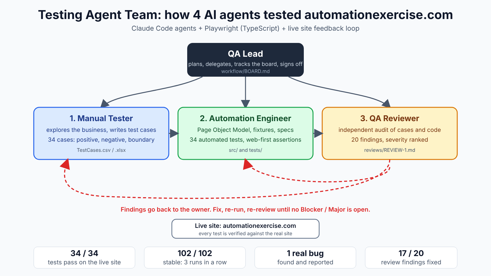

# Testing Agent Team: automationexercise.com QA



Run the team: open this folder in Claude Code and run `claude --agent qa-lead`.

## What was built
A four-agent QA team (definitions in `.claude/agents/`) and a Playwright + TypeScript UI test project:

| Agent | Role | What it produced |
|---|---|---|
| qa-lead | Plans, delegates, tracks `workflow/BOARD.md`, signs off | Task board and the work order |
| manual-tester | Explores the site, writes test cases | 34 cases in `test-cases/TestCases.csv` / `.xlsx` |
| automation-engineer | Page objects, fixtures, specs | `src/` and `tests/`: 34 automated tests |
| qa-reviewer | Independent audit | `reviews/REVIEW-1.md` (20 findings) and the resolution table |

## Results
- **34 of 34 tests pass** on the live site (final headed run, with video). Stability check: all tests three times in a row, **102 of 102 passed**.
- **1 real site bug:** BUG-001, contact form accepts empty Name, Subject and Message (only Email is required). See `reports/BUG_REPORT.md`.
- The review's 20 findings were fixed (17 fully, 2 partly, 1 minor left open).

## How the team worked
1. Test cases were drafted for 7 modules (login, contact, products, cart, checkout, subscription, UI).
2. The suite ran against the live site and failures were diagnosed one at a time: slow pages, clicks that happen before the site is ready, cleanup races, and wrong expectations (search also matches by category).
3. The reviewer audited the code and cases. Fixes were applied and the suite was rerun.
4. A stability run (3 times) and a final recorded run confirmed the result.

## Run it yourself
```
npm install --include=dev
set PW_CHANNEL=chrome        (use installed Chrome; or run: npx playwright install chromium)
npm test                     (all)     npm run test:smoke   (P0 only)
npm run report               (HTML report)
```
Extras: `PW_VIDEO=on` records every test, `PW_SLOWMO=150` slows actions so you can watch, `--headed` shows the browser.

## What is not done
Cross-browser, API tests, CI, and the extra scenarios in section 6 of `reports/FINAL_TEST_REPORT.md`.

## Where things are
`reports/` bug and test reports, `reviews/` review and resolution, `test-cases/` the sheet, `workflow/` board and known issues, `test-results/` videos, `playwright-report/` HTML report.
